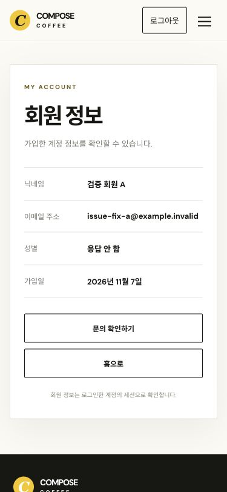
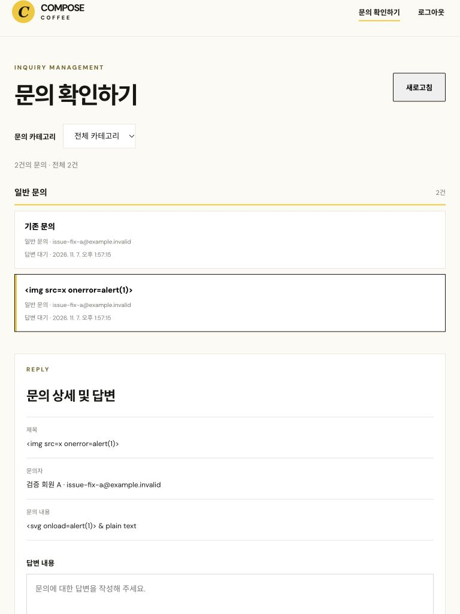

# 이슈 조치 기록 — 2026-11-07

기준은 `5856d3f`의 현재 작업 폴더이며, 이슈 #1·2·4·5·8·9·10·11·12·13·14·15를 수정하고 #6은 사용자 요구에 맞춰 조정했습니다. #7은 라이브 구현 확인 후 별도 수정을 제외했습니다. #3은 이번 요청 대상이 아닙니다.

## 항목별 조치

| 이슈 | 조치 또는 조정 | 검증 |
|---|---|---|
| [#1](https://github.com/JKim-99/coffee/issues/1) | 하트의 alert·강제 로그인 이동 제거. 인라인 상태와 명시적 로그인 링크·계속 둘러보기 제공. 로그인 링크에 선택 메뉴 보존. 링크 포커스로 화면·키보드 안내, 계속 둘러보기 후 카드로 복귀 | 자동 검사 및 실제 비회원 브라우저에서 페이지 유지·선택 메뉴 URL 확인 |
| [#2](https://github.com/JKim-99/coffee/issues/2) | 문의 정보 자동 입력·읽기 전용. 등록 API에 회원 인증 적용, 작성자 이름·이메일·회원 ID는 서버 세션에서 확정. 소유권 컬럼·인덱스를 새 0008 migration으로 추가. 기존 기록 보존 및 호환 처리 | 실제 D1에서 비회원 401, 위조 작성자 무시, 본인 200·다른 회원 404, 기존 문의 조회 확인 |
| [#3](https://github.com/JKim-99/coffee/issues/3) | 요청 대상에서 제외되어 관리자 비밀번호/로그인 정책 변경 없음 | 기존 검토 결과 유지. 운영 secret 변경·조회하지 않음 |
| [#4](https://github.com/JKim-99/coffee/issues/4) | 표시 이름과 원본 이름을 함께 검색. I-/H- 접두사의 아이스·핫 지정 의미 보존 | 원본·일반 이름·소문자 접두사 자동 검사, 브라우저 I-카페라떼 1건 확인 |
| [#5](https://github.com/JKim-99/coffee/issues/5) | 비밀번호 확인 필드 추가. 불일치 시 요청 전 차단, 인라인 오류·aria-invalid·문제 필드 포커스 | 불일치 요청 0건, 일치 시 정상 요청·확인값 서버 미전달 검사 |
| [#6](https://github.com/JKim-99/coffee/issues/6) | ‘본문 가운데 로그아웃 제거’ 의도 유지. 내 정보의 모바일 헤더에 메뉴를 열지 않고 사용할 로그아웃 버튼 배치 | 375px에서 메뉴 닫힘 상태의 상단 로그아웃 확인, 본문 버튼 없음 및 실제 로그아웃 확인 |
| [#7](https://github.com/JKim-99/coffee/issues/7) | 별도 수정 제외. 라이브 app.js의 aria-pressed·aria-label 갱신 함수와 favorites.js의 공통 갱신 호출 경로 확인. 내려받은 스크립트가 수정 전 로컬과 일치 | 기존 및 추가된 하트 검사 유지. 라이브 회원 계정 생성·저장은 수행하지 않음 |
| [#8](https://github.com/JKim-99/coffee/issues/8) | 서버·화면에서 공백 전용 비밀번호 거부. 일반 공백 포함 암호문과 Unicode 허용. 비밀번호를 trim하거나 문자 조합을 강제하지 않음 | 실제 API 공백 8자 400, 정상 암호 가입·로그인 성공, 공백 포함 암호 원문 보존 검사 |
| [#9](https://github.com/JKim-99/coffee/issues/9) | 회원 정보·로그아웃 기본 숨김, 인증 성공 시만 표시. 비회원 로그인·회원가입 노출 | 실제 로그아웃 후 계정 화면에서 회원 메뉴 숨김·로그인 안내 확인 |
| [#10](https://github.com/JKim-99/coffee/issues/10) | 선호 메뉴의 로딩·비회원·조회 장애·회원의 빈 목록·검색 실패 구분. 로그인 링크와 선호 탭 복귀 주소 제공 | 상태별 자동 검사 및 실제 비회원 선호 탭 확인 |
| [#11](https://github.com/JKim-99/coffee/issues/11) | 문의 링크 가로채기 제거해 공개 열람 허용. 등록은 서버에서도 인증. 비회원·세션 만료 시 인라인 로그인/머무르기 선택. 로그인 링크 클릭 시 초안을 sessionStorage에 임시 보관·복원 후 제거 | 실제 비회원 헤더 진입·로그인 후 원문 초안 복원, 세션 만료 자동 검사 |
| [#12](https://github.com/JKim-99/coffee/issues/12) | 공통 주요 헤더에 회원가입 링크 추가, 인증 성공 시 로그인·회원가입을 숨김 | 주요 페이지 HTML 검사, 인증 상태별 자동 검사 |
| [#13](https://github.com/JKim-99/coffee/issues/13) | 닉네임은 Unicode 이름·숫자·공백 및 일부 기호만 허용. HTML·제어 문자 차단. 문의 본문은 원문 텍스트 저장, 기존 textContent·출력 이스케이프 유지 및 회귀 검사 추가 | 실제 API HTML 닉네임 400, 본문의 태그 문자열은 관리자 화면에서 텍스트 표시·자식 요소 0 확인 |
| [#14](https://github.com/JKim-99/coffee/issues/14) | 이동 가능한 방향에만 좌우 버튼 표시, 스크롤 힌트·얇은 스크롤바 제공. resize/scroll 반영, 모션 감소 설정 존중 | 시작·끝 경계 자동 검사, 실제 375px 다음 버튼으로 이동 확인 |
| [#15](https://github.com/JKim-99/coffee/issues/15) | 작업 공간 기준으로 900px 이하 한 열, 그 이상 가변 목록+답변 패널. 기존이 좌측 360px 고정이었다는 설명은 정정 | 768px 입력 폭 약680px, 900px 한 열, 1024px 두 열·입력 폭 약592px 확인 |

## 조정한 해결 방향

- #6: 본문 버튼 복구 대신 모바일 상단 직접 로그아웃을 제공했습니다.
- #8: 영문·숫자·특수문자 조합 강제는 적용하지 않았습니다. 공백 전용 암호는 거부하지만 실제 암호 문자열을 변형하지 않습니다.
- #13: 저장 전에 특수문자를 일괄 HTML 엔티티로 바꾸지 않았습니다. 원문을 유지하고 출력 문맥에 맞춰 안전하게 표시합니다. 닉네임 입력 정책은 별도로 검증합니다.
- #15: 공통 680px와 분기점을 억지로 맞추지 않고 답변 공간을 확보하는 900px 기준을 사용했습니다.

## 검증 결과

- `npm test`: 52개 통과. 화면·서버·입력 검증·회원 소유권·초안 복원·기존 하트 동작 포함.
- 별도 임시 D1에 0001~0008 migration 적용, 합성 회원 2명으로 실제 API 검증.
- 익명 문의 차단, 요청 작성자 위조 방지, 본인·타인 상세 접근, 기존 이메일 문의 보존 확인.
- user_id 컬럼이 없는 상태를 임시 DB에서 재현해 저장·목록·상세의 호환 모드 확인, 컬럼 복원 후 ID 조회 확인.
- 실제 브라우저에서 공개 문의 열람, 명시적 로그인, 초안 복원, 읽기 전용 회원 정보, 모바일 상단 로그아웃, 비회원 메뉴 숨김, 관리자 태블릿 배치 확인.
- 운영 DB·실회원 데이터로 검증하지 않았습니다. 운영 배포 완료와는 구분합니다.

## 원격 DB 적용 상태

Cloudflare D1 원격 migration 조회에서 계정 권한 오류 `7403`이 발생해 원격 스키마를 확인·변경할 수 없었습니다. 0008은 로컬에서 검증했고, 운영 적용은 남아 있습니다.

호환 모드는 user_id 컬럼 누락이라는 정확한 DB 오류에만 동작합니다. 마이그레이션 전에도 비회원 등록을 차단하고 인증된 이메일만 저장·조회합니다. 0008 적용 후 새 문의부터 회원 ID를 저장합니다. 마이그레이션 전 기록을 임의로 회원 ID에 일괄 배정하지 않습니다.

운영 권한이 있는 계정에서 다음을 적용할 수 있습니다.

```sh
npx wrangler d1 migrations apply compose-coffee-inquiries --remote
```

## 화면 근거

합성 테스트 데이터만 표시한 화면입니다.




